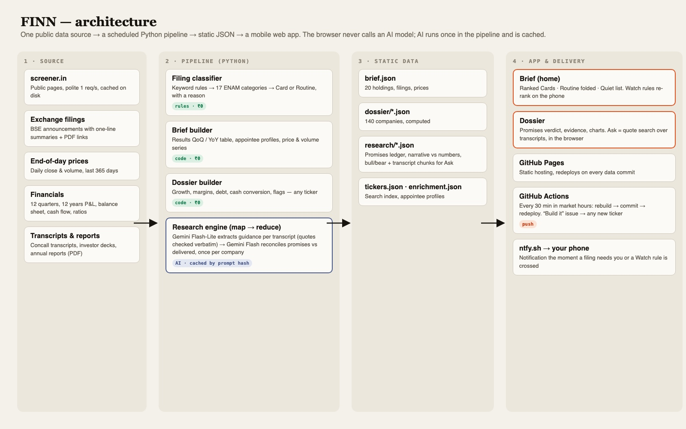

# FINN — Financial INvestment ageNt

**Try it (best on a phone):** https://kartikaya-git.github.io/finn/

FINN is a phone app for someone who owns shares in Indian companies (listed on NSE). Every day those companies publish dozens of official notices — results, management changes, lawsuits, routine paperwork. FINN reads all of them and shows you only the few that matter, and it can research any company for you using the company's own reports.

## What the app does

**Home screen — what needs your attention today**
- Shows everything that happened across your companies, most important first. Boring paperwork is folded into one line.
- Quarterly results show the key numbers (revenue, profit) compared with last quarter and last year.
- When a senior person joins or leaves, it shows who they are, taken from the company's own announcement.
- Alerts you when a share price moves or trading volume jumps more than you've set. You choose the limits.
- Tap **Clear** on an item once you've seen it. When everything is cleared, the screen says **All clear**.
- Phone notifications: a check runs every 30 minutes during market hours and sends new items to your phone (via the free ntfy app).

**Company page — research on demand**
- Opens with a verdict: how many of management's promises from the last four quarters they actually kept.
- Then the evidence: what management said vs what the numbers show, growth over the years, debt, whether profits turn into cash, and the case for and against.
- **Ask** searches the company's own earnings-call transcripts and shows the exact quotes.
- Uses only the company's own documents — no news articles or analyst opinions.
- 140 companies are ready. For any other NSE company, tap **Build it** and it is prepared in a few minutes.

An in-app guide (the **?** button on the home screen) walks through all of this step by step.

## Architecture



**Model routing.** Classification, tiering and every financial number are deterministic code: free, reproducible, explainable. A cheap model does bulk extraction over transcript chunks; a stronger model is called once per company per quarter for the one step that needs reasoning (reconciling promises with delivery). All LLM responses are cached by prompt hash, so reruns cost nothing. Ask is retrieval-only. The deployed app makes zero LLM calls.

**Primary sources only on the pull side.** Research is built from concall transcripts and results numbers; quotes are checked to be verbatim substrings of the source; the prompt forbids outside knowledge.

**Data source choice.** BSE, NSE and Yahoo block automated clients (Akamai 403s / 429s). screener.in republishes the same BSE filings (same PDF links), EOD price/volume and standardised financials, so one reliable source replaces three fragile ones.

**What the research run actually cost** (all 17 Gemini-researched Holdings):

| Step | Model | Calls | Tokens |
|---|---|---|---|
| Extract (per document) | gemini-3.5-flash-lite | 62 | 877k |
| Reconcile (per company) | gemini-3.8-flash | 16 | 134k (incl. 45k thinking) |
| **Total** | | **78** | **~1.0M — ₹0 on the free tier** |

87% of tokens go through the cheapest model; the strong model sees only compact extracts. 3–13% of extracted quotes failed the verbatim check and were dropped rather than shown. A rerun costs nothing (prompt-hash cache). Four companies (POLYCAB, KPITTECH, DIXON, PIDILITIND) were researched at build time with Claude as a quality benchmark for the Gemini pipeline; each Dossier names the model that produced it.

## Setting up your Gemini API key (optional)

FINN works without a key. Every Dossier's numbers, charts and flags are computed without any AI. The key only adds **transcript research** (the promises-vs-delivered verdict, narrative vs numbers, bull/bear) for companies built with **Build it** or the scheduled pipeline.

1. **Get a free key** at https://aistudio.google.com/apikey.
2. **To run on your own machine**, create a file named `.env` in the project root containing:
   ```
   GEMINI_API_KEY=your-key-here
   ```
   `.env` is in `.gitignore`, so it is never committed.
3. **To let GitHub's automated builds use it**, save it as a repository secret named `GEMINI_API_KEY`. Either:
   - on GitHub, go to **Settings → Secrets and variables → Actions → New repository secret**, or
   - from the project folder, run:
     ```bash
     grep '^GEMINI_API_KEY=' .env | cut -d= -f2- | tr -d '\n' | gh secret set GEMINI_API_KEY
     ```
   A secret is encrypted and never appears in the code, the commits or the logs. Even the repo owner can't read it back.

**Where the code reads the key:**

| File | What uses it |
|---|---|
| `pipeline/finn_research/finn_research/llm.py` (line 23) | Reads `GEMINI_API_KEY` from the environment, falling back to `.env`. All research calls go through here. |
| `.github/workflows/build-on-demand.yml` (line 35) | The **Build it** job passes `secrets.GEMINI_API_KEY` to the research step. |
| `.github/workflows/pipeline.yml` (line 25) | The scheduled pipeline passes the same secret. |

**If no key is set,** the research step is skipped (`continue-on-error`) and the Dossier is still published with all computed sections.

**Cost and abuse:** the free tier can't charge you. Because anyone can open a **Build it** issue on a public repo, someone could use up your daily free quota. They can never see the key.

## Run locally

```bash
# data
cd pipeline && uv run python -m finn build          # Brief + all Dossiers
uv run python -m finn dossier TATASTEEL             # any ticker
uv run python -m finn_research ITC                  # research layer (needs GEMINI_API_KEY in ../.env)

# app
cd web && npm i && npm run dev                      # http://localhost:5173/finn/
```

## Deliberately left out

| Left out | Why |
|---|---|
| **AI calls from the app itself** (e.g. a free-form chatbot) | The app is a static website, so any AI key in it would be visible to every visitor. Instead, the AI runs once in the pipeline, the result is cached, and the app only reads it. That also makes it free to run and quick to open, and every visitor sees the same checked analysis rather than a fresh answer that could differ each time. **Ask** searches the transcripts instead of generating text, so it can't invent anything. |
| **Intraday (live) prices** | The brief asks for end-of-day data, and the free sources that work reliably only give daily closes. Live prices would need a paid market-data feed. |
| **Login / user accounts** | It's a single-investor prototype with a fixed demo portfolio. Accounts would add sign-in screens and a database without changing what the app shows. Watch rules and cleared Cards are saved on the device instead. |
| **Editing the portfolio in the app** | The 20 holdings are set in the pipeline config. Making them editable needs per-user storage and a per-user pipeline run, which only makes sense after accounts exist. |
| **Scraping LinkedIn for appointee bios** | It's against LinkedIn's terms and breaks often. Indian listing rules (SEBI LODR) already require companies to attach a short profile of every new director or key executive to the appointment filing, so FINN reads that. It's the company's own disclosure, so it fits the primary-sources-only rule. |
| **BSE / NSE / Yahoo directly** | All three block automated requests (403 / 429 errors). screener.in republishes the same BSE filings, with the same PDF links, plus prices and financials, so one reliable source replaces three fragile ones. |
| **Native iOS / Android app** | A mobile website opens instantly from a link, with nothing to install. That matters most for a reviewer trying it once. Phone notifications come from the ntfy app instead. |

## Next

| Next step | Why it matters |
|---|---|
| **Notifications straight from the browser** (web push) | Today alerts need the free ntfy app. Web push would remove that install step, and it needs only a small server to hold subscriptions. |
| **AI help for unclear press releases** | Rules handle most filings well, but a press release can hide a big order win or a minor update behind the same wording. A cheap model reading only those few unclear filings would sharpen the ranking at very little cost. |
| **Refresh the research when a new earnings call lands** | Research is rebuilt manually today. Detecting a new transcript and re-running only that company would keep the promises verdict current within a day of each call. |
| **"What changed" view on the company page** | Investors care about change more than the current state, e.g. "management cut its margin target this quarter". Comparing this quarter's research with last quarter's would show exactly that. |
| **Your own portfolio** | Accounts plus an "add holding" screen, so each person's home screen ranks their own companies. |
| **Spoken morning summary** | A one-minute audio version of the home screen for the commute, built from the same ranked items. |

## Repo map
- `CONTEXT.md` — domain glossary (Brief, Card, Holding, Filing, Dossier, Ask, Watch rule…)
- `SPEC.md` — spec and data contract · `TICKETS.md` — build tickets
- `pipeline/` — data + research engines · `web/` — the app
